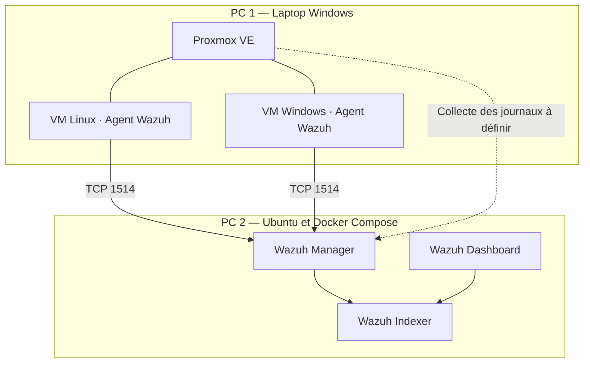

# Supervision et journalisation d’une infrastructure virtualisée

Projet académique **M352 — Sécurité de la virtualisation et du Cloud Computing**, ENSIASD.

**État du projet** — Architecture V0. La VM Linux et la VM Windows existent déjà. Leur import dans Proxmox VE, le déploiement de Wazuh et les tests sont à documenter après exécution.

## Objectif

Centraliser les journaux de Proxmox VE et des VM Linux et Windows dans Wazuh pour suivre les événements de sécurité, vérifier le déclenchement des alertes et conserver les traces nécessaires à l’analyse.

## Architecture prévue

Sur le **PC 1**, l’option envisagée consiste à exécuter Proxmox VE dans VMware Workstation. La création d’une VM dans Proxmox servira à vérifier que la virtualisation imbriquée fonctionne sur le laptop avant d’importer les deux VM existantes.

Sur le **PC 2**, Wazuh Manager, Indexer et Dashboard seront déployés avec Docker Compose sur Ubuntu. Les agents utiliseront l’adresse IP locale du serveur Wazuh. Les ports par défaut sont TCP 1515 pour l’enrôlement et TCP 1514 pour la communication des agents. La méthode de collecte des journaux Proxmox reste à choisir.

## Étapes de déploiement

- [ ] Vérifier la virtualisation imbriquée sur le laptop et démarrer une VM de test dans Proxmox.
- [ ] Importer d’abord la VM Linux, puis la VM Windows. Vérifier le démarrage et conserver les VM d’origine jusqu’à la validation.
- [ ] Déployer les trois services Wazuh sur le PC 2 et vérifier l’accès au tableau de bord.
- [ ] Tester la connectivité vers Wazuh depuis les deux VM, installer les agents et vérifier leur statut.
- [ ] Configurer la collecte des journaux de Proxmox et valider la durée de conservation des journaux.
- [ ] Exécuter les tests et ajouter les preuves au dépôt.

## Plan de validation

| Test | Résultat attendu | Preuve à joindre |
|---|---|---|
| Collecte Linux | Un événement d’authentification de la VM Linux est retrouvé dans Wazuh. | Événement horodaté avec le nom de l’agent. |
| Collecte Windows | Un événement du journal Sécurité de la VM Windows est retrouvé dans Wazuh. | Nom de l’agent et identifiant de l’événement. |
| Collecte Proxmox | Un événement généré sur l’hôte Proxmox est retrouvé dans Wazuh. | Source du journal, horodatage et type d’événement. |
| Déclenchement d’alerte | Un échec de connexion sur un compte de test déclenche une alerte si les conditions de la règle sont remplies. | Identifiant de la règle et capture de l’alerte. |
| Conservation | Un événement précédemment collecté reste consultable pendant la durée retenue. | Recherche datée et configuration de conservation. |

Pour chaque test, noter la date, le résultat observé et le statut **réussi** ou **échoué**. Masquer les identifiants et les informations sensibles dans les captures publiées.

## Références

- [Guide de migration vers Proxmox VE](https://pve.proxmox.com/wiki/Migrate_to_Proxmox_VE)
- [Déploiement Docker officiel de Wazuh](https://documentation.wazuh.com/current/deployment-options/docker/wazuh-container.html)
- [Architecture et ports Wazuh](https://documentation.wazuh.com/current/getting-started/architecture.html)
