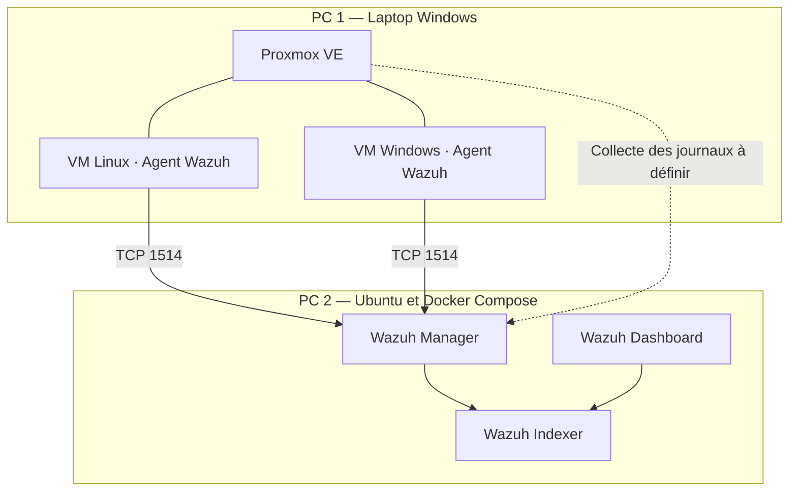
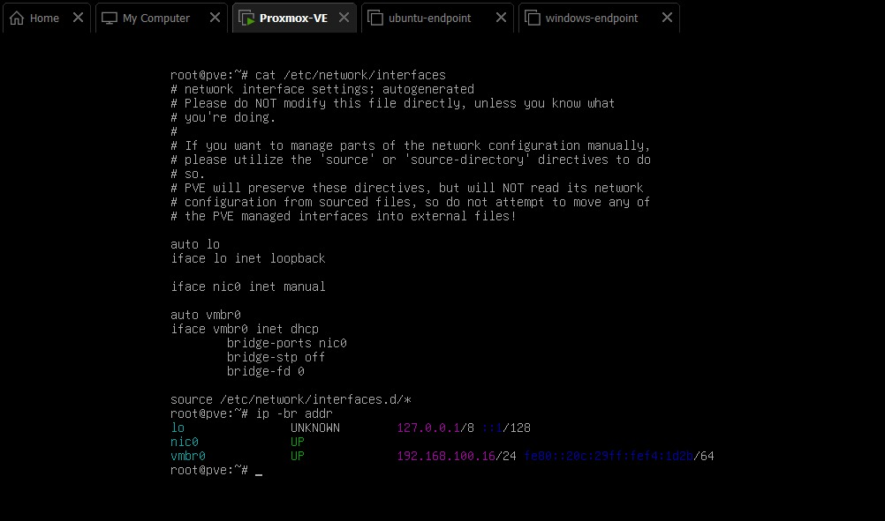

# Supervision et journalisation d’une infrastructure virtualisée

Projet académique **M352 — Sécurité de la virtualisation et du Cloud Computing**, ENSIASD.

**État du projet** — L’interface de Proxmox VE est accessible depuis le laptop et la configuration réseau du nœud est documentée. Les VM Linux et Windows existent déjà. Leur import dans Proxmox, le déploiement de Wazuh et les tests restent à documenter.

## Objectif

Centraliser les journaux de Proxmox VE et des VM Linux et Windows dans Wazuh pour suivre les événements de sécurité, vérifier le déclenchement des alertes et conserver les traces nécessaires à l’analyse.

## Architecture prévue



Sur le **PC 1**, Proxmox VE est accessible depuis le laptop Windows. Le démarrage d’une VM à l’intérieur de Proxmox servira à valider la virtualisation imbriquée avant l’import des deux VM existantes.

Sur le **PC 2**, Wazuh Manager, Indexer et Dashboard seront déployés avec Docker Compose sur Ubuntu. Les agents utiliseront l’adresse IP locale du serveur Wazuh. Les ports par défaut sont TCP 1515 pour l’enrôlement et TCP 1514 pour la communication des agents. La méthode de collecte des journaux Proxmox reste à choisir.

## Étape 1 — Accéder à Proxmox VE et vérifier son réseau

### 1.1 Vérifier l’accès à l’interface web

Depuis le navigateur du laptop Windows, l’interface d’administration s’ouvre à l’adresse `https://192.168.100.16:8006`. La vue **Datacenter** affiche **Proxmox VE 9.3.1**, le nœud `pve` et les espaces de stockage `local` et `local-lvm`.


*Figure 1 — Accès à l’interface d’administration du nœud Proxmox.*

Le navigateur signale un problème de confiance avec le certificat HTTPS. La capture montre aussi un échec de la tâche **Update package database**. Le détail de cette tâche sera nécessaire pour en identifier la cause.

### 1.2 Identifier le pont réseau `vmbr0`

Deux commandes ont été exécutées dans la console de Proxmox.

```bash
cat /etc/network/interfaces
ip -br addr
```

La première affiche la configuration réseau. La seconde résume l’état des interfaces et leurs adresses IP.



*Figure 2 — Configuration du pont réseau et adresse IPv4 observée sur Proxmox.*

| Élément | Observation | Rôle dans le lab |
|---|---|---|
| `nic0` | Interface active, configurée en mode manuel. | Relie le pont au réseau de la VM Proxmox. |
| `vmbr0` | Pont actif, associé à `nic0` via `bridge-ports nic0`. | Porte l’adresse d’administration et pourra servir à connecter les VM au réseau. |
| IPv4 de `vmbr0` | `192.168.100.16/24` lors de la capture. | Adresse utilisée pour ouvrir l’interface web depuis le laptop. Elle est attribuée par DHCP et peut changer. |

**Validation obtenue** — Le laptop atteint l’interface web de Proxmox et le pont `vmbr0` dispose d’une adresse IPv4. Le prochain test consiste à démarrer une VM dans Proxmox, puis à vérifier son accès au réseau du lab.

## Étapes de déploiement

- [x] Accéder à l’interface de Proxmox et relever la configuration de `vmbr0`.

- [ ] Vérifier la virtualisation imbriquée sur le laptop et démarrer une VM de test dans Proxmox.
- [ ] Importer d’abord la VM Linux, puis la VM Windows. Vérifier le démarrage et conserver les VM d’origine jusqu’à la validation.
- [ ] Déployer les trois services Wazuh sur le PC 2 et vérifier l’accès au tableau de bord.
- [ ] Tester la connectivité vers Wazuh depuis les deux VM, installer les agents et vérifier leur statut.
- [ ] Configurer la collecte des journaux de Proxmox et valider la durée de conservation des journaux.
- [ ] Exécuter les tests et ajouter les preuves au dépôt.

## Plan de validation

| Test | Résultat attendu | Preuve à joindre |
|---|---|---|
| Collecte Linux | Un événement d’authentification de la VM Linux est retrouvé dans Wazuh. | Événement horodaté avec le nom de l’agent. |
| Collecte Windows | Un événement du journal Sécurité de la VM Windows est retrouvé dans Wazuh. | Nom de l’agent et identifiant de l’événement. |
| Collecte Proxmox | Un événement généré sur l’hôte Proxmox est retrouvé dans Wazuh. | Source du journal, horodatage et type d’événement. |
| Déclenchement d’alerte | Un échec de connexion sur un compte de test déclenche une alerte si les conditions de la règle sont remplies. | Identifiant de la règle et capture de l’alerte. |
| Conservation | Un événement précédemment collecté reste consultable pendant la durée retenue. | Recherche datée et configuration de conservation. |

Pour chaque test, noter la date, le résultat observé et le statut **réussi** ou **échoué**. Masquer les identifiants et les informations sensibles dans les captures publiées.

## Références

- [Guide de migration vers Proxmox VE](https://pve.proxmox.com/wiki/Migrate_to_Proxmox_VE)
- [Déploiement Docker officiel de Wazuh](https://documentation.wazuh.com/current/deployment-options/docker/wazuh-container.html)
- [Architecture et ports Wazuh](https://documentation.wazuh.com/current/getting-started/architecture.html)
