# Supervision et journalisation d’une infrastructure virtualisée

Projet académique **M352 — Sécurité de la virtualisation et du Cloud Computing**, ENSIASD.

**État du projet** — L’interface de Proxmox VE est accessible depuis le laptop et la configuration réseau et l’état du stockage `local` sont documentés. La VM Ubuntu (ID 100) démarre sur Proxmox et possède une adresse IPv4. Le serveur Wazuh est déployé sur Fedora 43 avec Docker Compose et son tableau de bord est accessible. Les agents Wazuh d’Ubuntu et du nœud Proxmox sont actifs dans le tableau de bord. La surveillance de `journald` est activée sur Proxmox. La réception des journaux de ces deux sources et l’import de la VM Windows restent à documenter.

## Objectif

Centraliser les journaux de Proxmox VE et des VM Linux et Windows dans Wazuh pour suivre les événements de sécurité, vérifier le déclenchement des alertes et conserver les traces nécessaires à l’analyse.

## Architecture prévue

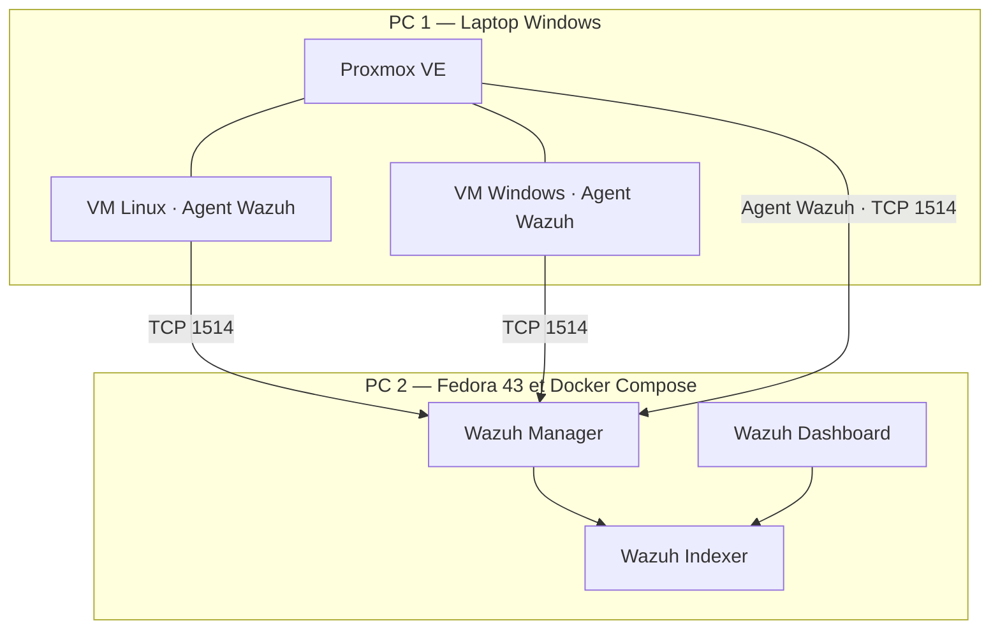

Sur le **PC 1**, Proxmox VE est accessible depuis le laptop Windows. La VM Ubuntu démarre désormais dans Proxmox, comme le montre la section 3.2. L’import de la VM Windows reste à documenter.

Sur le **PC 2**, Wazuh Manager, Indexer et Dashboard s’exécutent avec Docker Compose sur Fedora 43. L’adresse du manager Wazuh est `192.168.100.238`. Les ports par défaut sont TCP 1515 pour l’enrôlement et TCP 1514 pour la communication des agents. L’agent installé sur Proxmox surveille les entrées de `journald`.

## Étape 0 — Activer la virtualisation imbriquée pour Proxmox

Proxmox VE s’exécute dans une VM VMware Workstation sur le laptop Windows. Pour que Proxmox puisse à son tour héberger des VM, VMware doit lui exposer les extensions matérielles de virtualisation du processeur.

1. **Sur le laptop Windows**, la sécurité basée sur la virtualisation (VBS) a été désactivée pour cette configuration du lab. Broadcom indique que VBS peut empêcher VMware Workstation d’exposer les extensions de virtualisation à une VM. Voir la [note technique Broadcom](https://knowledge.broadcom.com/external/article/389469/virtualized-intel-vtxept-is-not-supporte.html).
2. **Dans VMware Workstation**, ouvrir les paramètres de la VM **Proxmox VE**, puis **Processors**. Dans **Virtualization engine**, cocher **Virtualize Intel VT-x/EPT or AMD-V/RVI**. La capture montre que cette option est cochée et que **2 cœurs virtuels** sont attribués à la VM.

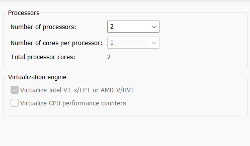

*Figure 0 — Paramètres du processeur de la VM Proxmox dans VMware Workstation.*

Après le démarrage de Proxmox, le lancement d’Ubuntu dans la VM 100 a confirmé que cette configuration permettait d’exécuter une VM à l’intérieur de Proxmox (voir la section 3.2).

## Étape 1 — Repérer l’adresse IP et ouvrir Proxmox VE

### 1.1 Repérer l’adresse IP de Proxmox

Deux commandes ont été exécutées dans la console de Proxmox.

```bash
cat /etc/network/interfaces
ip -br addr
```

La première affiche la configuration réseau. La seconde résume l’état des interfaces et leurs adresses IP. Sur la ligne `vmbr0`, l’interface est `UP` et l’IPv4 affichée est `192.168.100.16/24`.


*Figure 1 — Configuration du pont réseau et adresse IPv4 observée sur Proxmox.*

| Élément | Observation | Rôle dans le lab |
|---|---|---|
| `nic0` | Interface active, configurée en mode manuel. | Relie le pont au réseau de la VM Proxmox. |
| `vmbr0` | Pont actif, associé à `nic0` via `bridge-ports nic0`. | Porte l’adresse d’administration et pourra servir à connecter les VM au réseau. |
| IPv4 de `vmbr0` | `192.168.100.16/24` lors de la capture. | Adresse utilisée pour ouvrir l’interface web depuis le laptop. Elle est attribuée par DHCP et peut changer. |

### 1.2 Ouvrir l’interface graphique

Une fois l’adresse IP repérée, ouvrir le navigateur du laptop Windows et saisir `https://192.168.100.16:8006`. Saisir l’IPv4 sans le suffixe `/24`, qui indique la longueur du préfixe réseau. La vue **Datacenter** affiche **Proxmox VE 9.3.1**, le nœud `pve` et les espaces de stockage `local` et `local-lvm`.

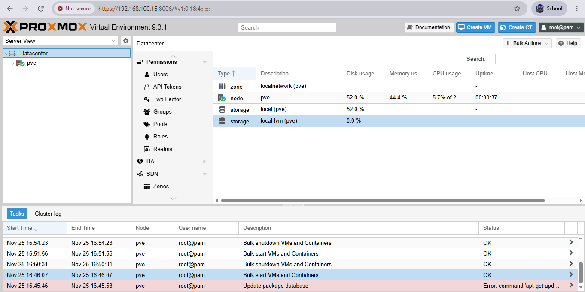

*Figure 2 — Accès à l’interface d’administration du nœud Proxmox.*

Le navigateur signale un problème de confiance avec le certificat HTTPS. La capture montre aussi un échec de la tâche **Update package database**. Le détail de cette tâche sera nécessaire pour en identifier la cause.

**Validation obtenue** — Le laptop atteint l’interface web de Proxmox et le pont `vmbr0` dispose d’une adresse IPv4. Le prochain test consiste à démarrer une VM dans Proxmox, puis à vérifier son accès au réseau du lab.

## Étape 2 — Vérifier le stockage après modification

Dans l’interface de Proxmox, ouvrir **Datacenter → pve → local (pve) → Summary**. Cette vue permet de vérifier que le stockage est disponible avant d’y transférer les fichiers des VM.


*Figure 3 — Capacité, utilisation et types de contenu du stockage `local`.*

| Élément | Valeur observée |
|---|---|
| Type de stockage | `Directory` |
| État | Activé et actif |
| Capacité affichée | 40,64 Go |
| Espace utilisé | 8,90 Go (21,89 %) |
| Espace disponible estimé | 31,74 Go |
| Types de contenu autorisés | Images de disque, fichiers d’import, images ISO et modèles de conteneurs |

**Validation obtenue** — Le stockage `local` est actif et le type de contenu **Import** est autorisé. La capture documente la capacité après modification. La capacité initiale et la taille de l’augmentation restent à renseigner. Avant de transférer l’export de la VM Linux, comparer sa taille à l’espace disponible et prévoir l’espace nécessaire au disque importé sur le stockage de destination.

## Étape 3 — Ajouter la VM Ubuntu dans Proxmox

La VM Ubuntu apparaît sous le nœud `pve` avec l’identifiant `100`. Pour vérifier que son disque apparaît sur le stockage choisi, ouvrir **Datacenter → pve → local (pve) → VM Disks**.

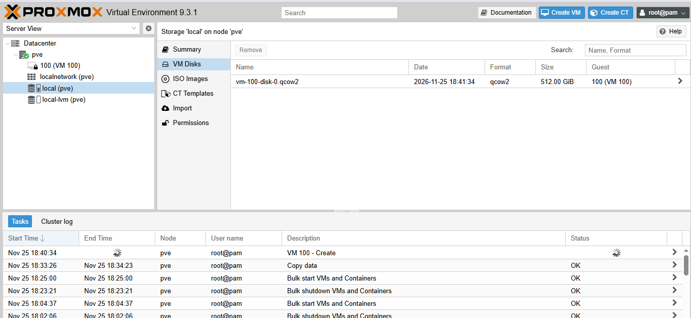

*Figure 4 — VM Ubuntu en cours de création et disque associé dans le stockage `local`.*

| Élément | Valeur observée |
|---|---|
| Identifiant de la VM | `100` |
| Stockage | `local (pve)` |
| Disque | `vm-100-disk-0.qcow2` |
| Format | `qcow2` |
| Capacité virtuelle affichée | 512,00 GiB |
| Tâche | `VM 100 - Create`, en cours au moment de la capture |

Les **512 GiB** correspondent à la capacité virtuelle du disque. Sur le stockage `local`, l’espace réellement utilisé par ce fichier reste à mesurer avant de poursuivre les imports.

### 3.1 Suivre le transfert du disque avant le démarrage

Dans **Tasks → VM 100 - Create → Output**, le transfert du disque est à **51,03 %** au moment de la capture (`261.3 GiB of 512.0 GiB` dans le journal). Cette valeur indique la progression du traitement du disque virtuel. L’espace occupé sur le stockage `local` doit être contrôlé séparément.

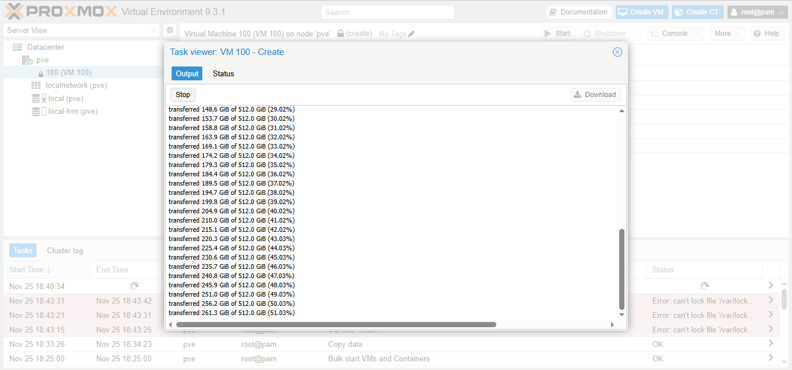

*Figure 5 — Transfert du disque en cours et tentatives de démarrage bloquées.*

La mention `(create)` indique que la VM est verrouillée pendant sa création. Les tentatives de démarrage visibles dans la liste des tâches échouent avec le message `can't lock file`. Laisser le transfert se terminer avant de relancer le démarrage.

Une fois la tâche de création terminée, démarrer la VM avec **VM 100 → Start**, puis ouvrir **Console**.

### 3.2 Confirmer le démarrage d’Ubuntu et relever son adresse IP

Dans **pve → 100 (vm-ubuntu) → Console**, le bureau Ubuntu est affiché et le terminal répond aux commandes suivantes.

```bash
ip a
hostname
```


*Figure 6 — Bureau Ubuntu dans la console Proxmox et vérification de l’identité réseau de la VM.*

| Élément | Valeur observée |
|---|---|
| Nom de la VM dans Proxmox | `vm-ubuntu` (ID `100`) |
| Nom d’hôte dans Ubuntu | `ubuntu-endpoint` |
| Interface réseau | `ens18`, état `UP` |
| IPv4 dans Ubuntu | `192.168.100.229/24`, attribuée dynamiquement |

**Validation obtenue** — Ubuntu a démarré et dispose d’une adresse dans le réseau `192.168.100.0/24`. La configuration de l’agent Wazuh est détaillée à l’étape 5.

## Étape 4 — Déployer le serveur Wazuh sur Fedora 43

Le PC 2 héberge les trois composants Wazuh sur une seule machine. **Manager** reçoit et analyse les événements, **Indexer** stocke et indexe les alertes, et **Dashboard** permet de les consulter. Le déploiement utilise le mode `single-node` du dépôt officiel `wazuh-docker`, au tag `v4.14.10`.

### 4.1 Vérifier les prérequis et préparer Fedora

| Vérification | Résultat relevé avant le déploiement |
|---|---|
| Docker Engine | 29.10.0, service actif |
| Docker Compose | 5.7.1 |
| Git | 2.56.1 |
| `vm.max_map_count` | 1048576 avant modification |
| Ports TCP contrôlés | Aucune écoute relevée sur 443, 1514, 1515, 9200 et 55000 |
| Conteneurs existants | Minikube et hello-world à l’arrêt |

Le paramètre noyau `vm.max_map_count` fixe le nombre maximal de zones mémoire qu’un processus peut mapper. L’équipe a enregistré la valeur `262144` dans un fichier de configuration persistant pour Wazuh Indexer, puis a rechargé la configuration système.

```bash
echo "vm.max_map_count=262144" | sudo tee /etc/sysctl.d/99-wazuh-max-map-count.conf
sudo sysctl --system
```

### 4.2 Récupérer la configuration Docker Compose

```bash
cd ~/Downloads
git clone https://github.com/wazuh/wazuh-docker.git -b v4.14.10
cd wazuh-docker/single-node
ls -la
```

Le répertoire contient le fichier `docker-compose.yml`, la configuration des services dans `config/` et le fichier `generate-indexer-certs.yml`.

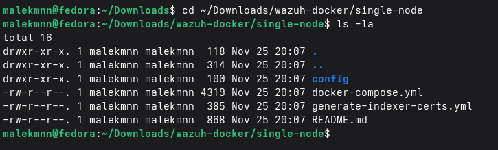

*Figure 7 — Fichiers de déploiement Docker Compose.*

### 4.3 Générer et vérifier les certificats TLS

```bash
docker compose -f generate-indexer-certs.yml run --rm generator
sudo ls -lh config/wazuh_indexer_ssl_certs/
```

Le générateur crée l’autorité de certification ainsi que les certificats et clés utilisés par les composants Wazuh. L’option `--rm` supprime le conteneur de génération après son exécution. Le journal affiche aussi `find: command not found`. La seconde capture montre que les fichiers attendus sont présents dans leur dossier de destination.

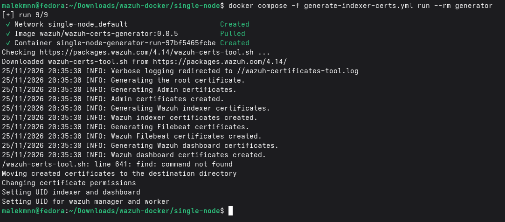

*Figure 8 — Génération des certificats TLS.*

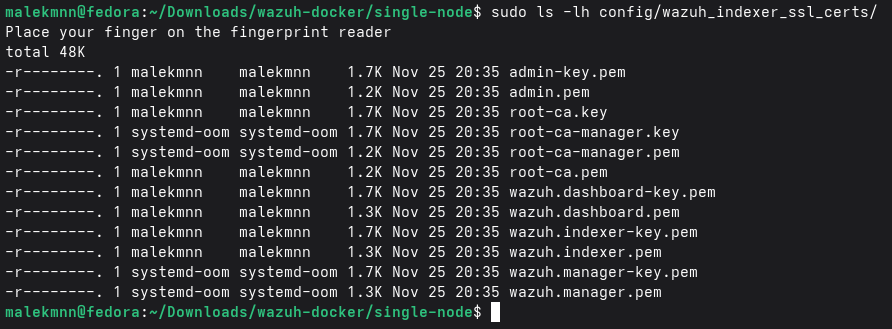

*Figure 9 — Vérification des fichiers générés dans `config/wazuh_indexer_ssl_certs/`.*

### 4.4 Démarrer Manager, Indexer et Dashboard

```bash
docker compose up -d
```

Docker Compose télécharge les images, crée les volumes et lance les trois services. La sortie affiche `Started` pour les conteneurs Manager, Indexer et Dashboard.

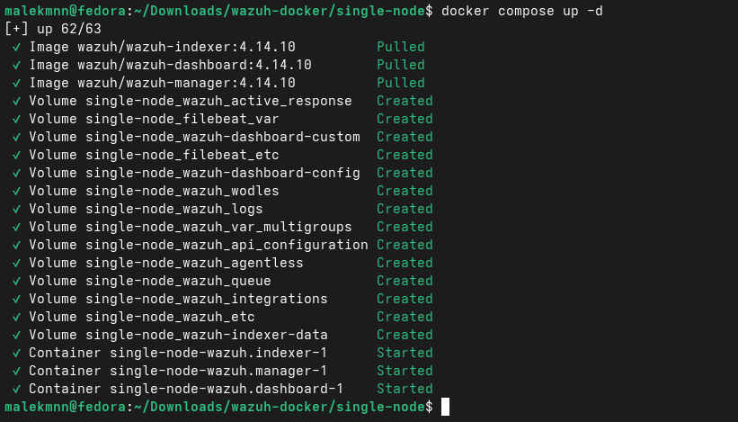

*Figure 10 — Démarrage des services Wazuh.*

| Port du fichier Compose v4.14.10 | Usage |
|---|---|
| TCP 443 | Accès HTTPS au Dashboard |
| TCP 1514 | Communication des agents avec le Manager |
| TCP 1515 | Enrôlement des agents |
| TCP 55000 | API du Manager |
| TCP 9200 | API de l’Indexer |
| UDP 514 | Publication du port Syslog, à configurer si ce mode de collecte est retenu |

### 4.5 Vérifier l’accès au tableau de bord

Depuis Fedora, la page de connexion s’affiche dans le navigateur. Après authentification, la vue **Overview** s’ouvre à l’adresse locale. Cette capture date d’avant l’enrôlement de l’agent Ubuntu. La connexion des agents et les journaux reçus font l’objet de vérifications propres à l’étape suivante.


*Figure 11 — Page de connexion Wazuh.*

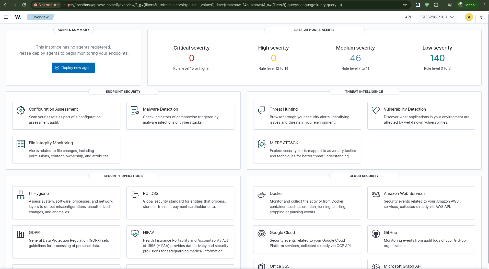

*Figure 12 — Tableau de bord opérationnel, avant l’enrôlement des agents.*


## Étape 5 — Connecter l’agent Ubuntu au manager Wazuh

Sur la VM `ubuntu-endpoint` (ID `100`), le paquet `wazuh-agent` a été installé depuis le dépôt APT Wazuh. La variable `WAZUH_MANAGER` indique l’adresse du manager sur le PC 2. Les commandes suivantes reprennent celles exécutées dans la capture.

```bash
sudo WAZUH_MANAGER="192.168.100.238" apt-get install wazuh-agent
sudo systemctl daemon-reload
sudo systemctl enable wazuh-agent
sudo systemctl start wazuh-agent
sudo systemctl status wazuh-agent
```

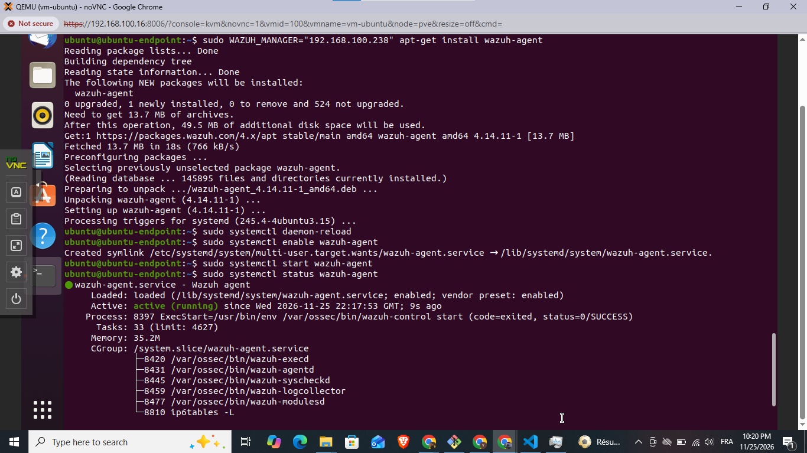

*Figure 13 — Agent Wazuh installé, activé au démarrage et en cours d’exécution sur Ubuntu.*

| Vérification | Résultat |
|---|---|
| Version du paquet | `4.14.11-1` |
| Manager configuré | `192.168.100.238` |
| Service sur Ubuntu | `enabled` et `active (running)` |
| Connexion au manager | Confirmée dans la vue **Endpoints** du tableau de bord (figure 14). |
| Réception des journaux | À vérifier avec un événement généré sur Ubuntu. |

### 5.1 Vérifier l’enrôlement dans Wazuh

Dans le tableau de bord, ouvrir **Endpoints** et rechercher `ubuntu-endpoint`. La vue affiche **1 agent actif**. L’adresse affichée correspond à celle relevée dans Ubuntu à l’étape 3.2.

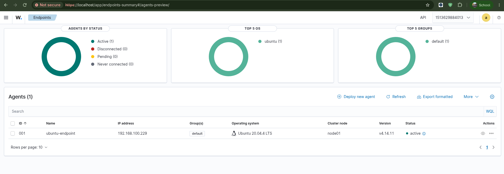

*Figure 14 — Agent Ubuntu enrôlé et actif dans Wazuh.*

| Élément | Valeur observée |
|---|---|
| ID de l’agent Wazuh | `001` |
| Nom et adresse IP | `ubuntu-endpoint` · `192.168.100.229` |
| Système | Ubuntu 20.04.4 LTS |
| Groupe et nœud Wazuh | `default` · `node01` |
| Version de l’agent | `v4.14.11` |
| Statut | `active` |

Le statut confirme que l’agent communique avec le manager. Pour valider la collecte, il reste à générer un événement sur Ubuntu et à le retrouver dans Wazuh.

**Versions relevées** — Le déploiement serveur documenté utilise Wazuh `4.14.10`. La capture Ubuntu montre un agent `4.14.11-1`. La version actuelle du Manager reste à relever. Wazuh demande que le Manager soit de la même version que l’agent ou d’une version plus récente. Voir le [guide de compatibilité Wazuh](https://documentation.wazuh.com/current/upgrade-guide/index.html).

## Étape 6 — Superviser le nœud Proxmox avec Wazuh

### 6.1 Installer l’agent et activer la surveillance de `journald`

Dans la console du nœud Proxmox `pve), le paquet `wazuh-agent` en version `4.14.11-1` a été installé. La sortie montre que le service est activé au démarrage (`enabled`) et en cours d’exécution (`active (running)`). La ligne `Monitoring journal entries` confirme que le collecteur Wazuh surveille les entrées du journal système.

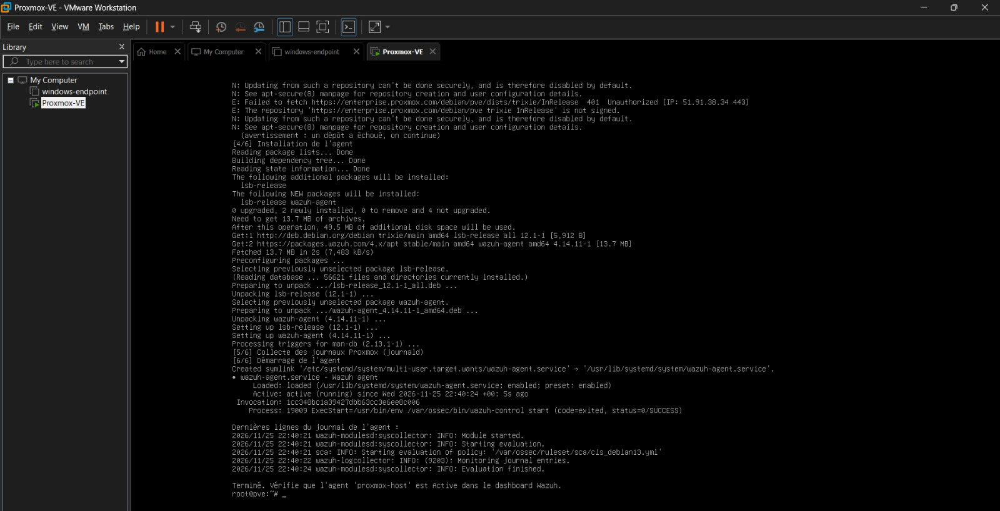

*Figure 15 — Installation et démarrage de l’agent Wazuh sur le nœud Proxmox.*

Lors de la mise à jour des index APT, le dépôt Proxmox Enterprise a répondu `401 Unauthorized`. La suite de la sortie montre que l’installation depuis le dépôt Wazuh a abouti.

### 6.2 Confirmer la connexion au manager

Dans **Endpoints**, Wazuh affiche deux agents actifs dans le groupe `default`.

| ID Wazuh | Agent | Adresse IP | Système | Version de l’agent | Statut |
|---|---|---|---|---|---|
| `002` | `proxmox-host` | `192.168.100.16` | Debian GNU/Linux 13 | `v4.14.11` | `active` |
| `001` | `ubuntu-endpoint` | `192.168.100.229` | Ubuntu 20.04.4 LTS | `v4.14.11` | `active` |

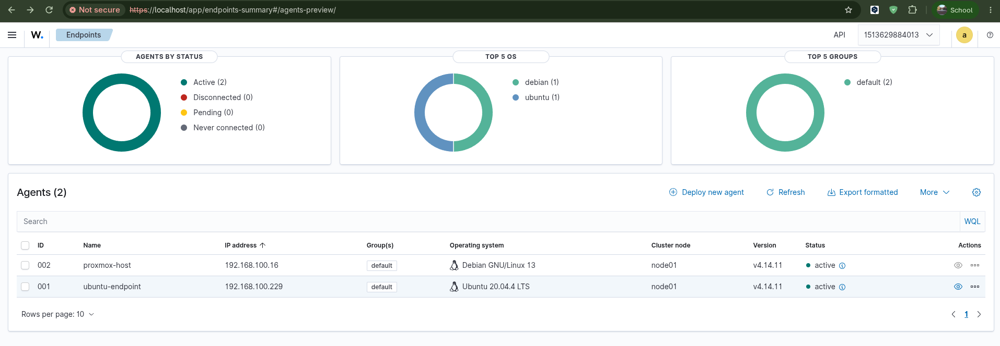

*Figure 16 — Deux agents actifs dans la vue Endpoints de Wazuh.*

**Validation obtenue** — Le nœud Proxmox et la VM Ubuntu communiquent avec le manager. Pour valider la collecte de bout en bout, il reste à retrouver dans Wazuh un événement issu de `journald` sur `proxmox-host`.

## Étapes de déploiement

- [x] Activer la virtualisation imbriquée pour la VM Proxmox dans VMware Workstation.
- [x] Repérer l’adresse IP de `vmbr0`, puis accéder à l’interface de Proxmox.
- [x] Vérifier l’état, la capacité et les types de contenu du stockage `local`.
- [x] Lancer l’ajout de la VM Ubuntu dans Proxmox et repérer son disque dans `local`.
- [x] Confirmer le démarrage d’Ubuntu dans la console Proxmox et relever son adresse IPv4.
- [ ] Importer la VM Windows et vérifier son démarrage. Conserver les VM d’origine jusqu’à la validation.
- [x] Déployer les trois services Wazuh sur le PC 2 et vérifier l’accès au tableau de bord.
- [x] Installer et démarrer l’agent Wazuh sur Ubuntu en ciblant le manager du PC 2.
- [x] Vérifier l’enrôlement et le statut actif de l’agent Ubuntu dans Wazuh.
- [ ] Vérifier la réception d’un journal généré sur Ubuntu.
- [ ] Installer l’agent Windows et vérifier sa connectivité au manager.
- [x] Installer l’agent sur Proxmox, activer la surveillance de `journald` et vérifier son statut dans Wazuh.
- [ ] Vérifier la réception d’un événement `journald` de Proxmox et valider la durée de conservation des journaux.
- [ ] Exécuter les tests et ajouter les preuves au dépôt.

## Plan de validation

| Test | Résultat attendu | Preuve à joindre |
|---|---|---|
| Collecte Linux | Un événement d’authentification de la VM Linux est retrouvé dans Wazuh. | Événement horodaté avec le nom de l’agent. |
| Collecte Windows | Un événement du journal Sécurité de la VM Windows est retrouvé dans Wazuh. | Nom de l’agent et identifiant de l’événement. |
| Collecte Proxmox | Un événement généré sur l’hôte Proxmox est retrouvé dans Wazuh. | Source du journal, horodatage et type d’événement. |
| Déclenchement d’alerte | Un échec de connexion sur un compte de test déclenche une alerte si les conditions de la règle sont remplies. | Identifiant de la règle et capture de l’alerte. |
| Conservation | Un événement précédemment collecté reste consultable pendant la durée retenue. | Recherche datée et configuration de conservation. |

Pour chaque test, noter la date, le résultat observé et le statut **réussi** ou **échoué**. Masquer les identifiants et les informations sensibles dans les captures publiées.

## Références

- [Guide de migration vers Proxmox VE](https://pve.proxmox.com/wiki/Migrate_to_Proxmox_VE)
- [Déploiement Docker officiel de Wazuh](https://documentation.wazuh.com/current/deployment-options/docker/wazuh-container.html)
- [Fichier Docker Compose Wazuh v4.14.10](https://github.com/wazuh/wazuh-docker/blob/v4.14.10/single-node/docker-compose.yml)
- [Architecture et ports Wazuh](https://documentation.wazuh.com/current/getting-started/architecture.html)
