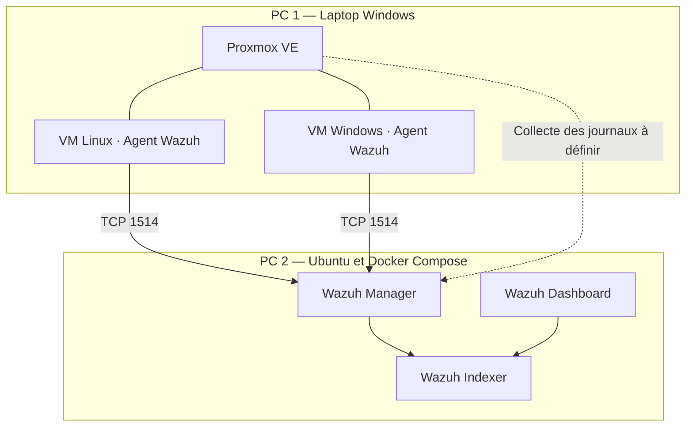
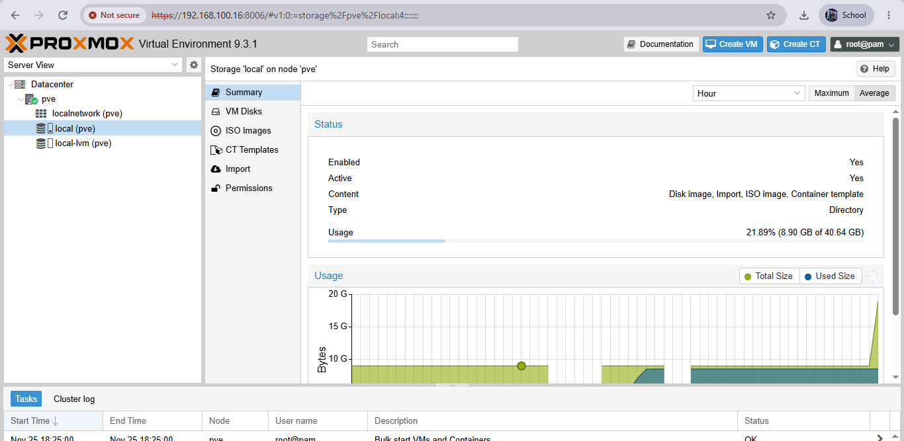
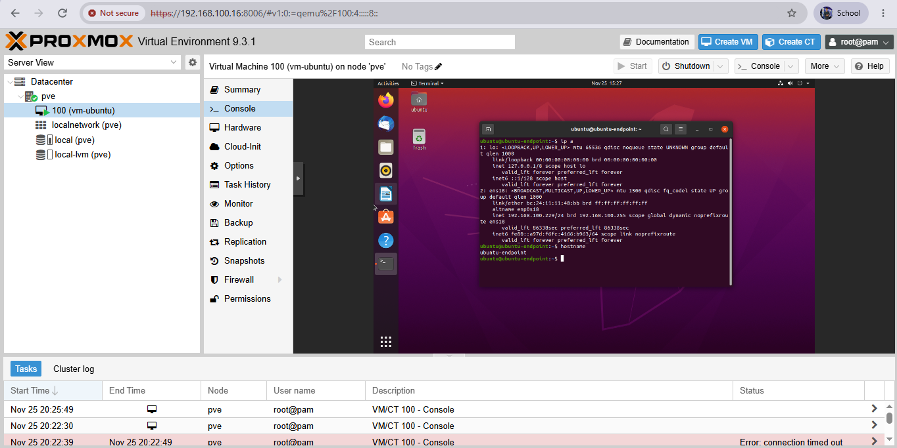

# Supervision et journalisation d’une infrastructure virtualisée

Projet académique **M352 — Sécurité de la virtualisation et du Cloud Computing**, ENSIASD.

**État du projet** — L’interface de Proxmox VE est accessible depuis le laptop et la configuration réseau et l’état du stockage `local` sont documentés. La VM Ubuntu (ID 100) démarre sur Proxmox et possède une adresse IPv4. L’import de la VM Windows, le déploiement de Wazuh et les tests de connectivité restent à documenter.

## Objectif

Centraliser les journaux de Proxmox VE et des VM Linux et Windows dans Wazuh pour suivre les événements de sécurité, vérifier le déclenchement des alertes et conserver les traces nécessaires à l’analyse.

## Architecture prévue



Sur le **PC 1**, Proxmox VE est accessible depuis le laptop Windows. La VM Ubuntu démarre désormais dans Proxmox, comme le montre la section 3.2. L’import de la VM Windows reste à documenter.

Sur le **PC 2**, Wazuh Manager, Indexer et Dashboard seront déployés avec Docker Compose sur Ubuntu. Les agents utiliseront l’adresse IP locale du serveur Wazuh. Les ports par défaut sont TCP 1515 pour l’enrôlement et TCP 1514 pour la communication des agents. La méthode de collecte des journaux Proxmox reste à choisir.

## Étape 1 — Repérer l’adresse IP et ouvrir Proxmox VE

### 1.1 Repérer l’adresse IP de Proxmox

Deux commandes ont été exécutées dans la console de Proxmox.

```bash
cat /etc/network/interfaces
ip -br addr
```

La première affiche la configuration réseau. La seconde résume l’état des interfaces et leurs adresses IP. Sur la ligne `vmbr0`, l’interface est `UP` et l’IPv4 affichée est `192.168.100.16/24`.


*Figure 1 — Configuration du pont réseau et adresse IPv4 observée sur Proxmox.*

| Élément | Observation | Rôle dans le lab |
|---|---|---|
| `nic0` | Interface active, configurée en mode manuel. | Relie le pont au réseau de la VM Proxmox. |
| `vmbr0` | Pont actif, associé à `nic0` via `bridge-ports nic0`. | Porte l’adresse d’administration et pourra servir à connecter les VM au réseau. |
| IPv4 de `vmbr0` | `192.168.100.16/24` lors de la capture. | Adresse utilisée pour ouvrir l’interface web depuis le laptop. Elle est attribuée par DHCP et peut changer. |

### 1.2 Ouvrir l’interface graphique

Une fois l’adresse IP repérée, ouvrir le navigateur du laptop Windows et saisir `https://192.168.100.16:8006`. Saisir l’IPv4 sans le suffixe `/24`, qui indique la longueur du préfixe réseau. La vue **Datacenter** affiche **Proxmox VE 9.3.1**, le nœud `pve` et les espaces de stockage `local` et `local-lvm`.


*Figure 2 — Accès à l’interface d’administration du nœud Proxmox.*

Le navigateur signale un problème de confiance avec le certificat HTTPS. La capture montre aussi un échec de la tâche **Update package database**. Le détail de cette tâche sera nécessaire pour en identifier la cause.

**Validation obtenue** — Le laptop atteint l’interface web de Proxmox et le pont `vmbr0` dispose d’une adresse IPv4. Le prochain test consiste à démarrer une VM dans Proxmox, puis à vérifier son accès au réseau du lab.

## Étape 2 — Vérifier le stockage après modification

Dans l’interface de Proxmox, ouvrir **Datacenter → pve → local (pve) → Summary**. Cette vue permet de vérifier que le stockage est disponible avant d’y transférer les fichiers des VM.



*Figure 3 — Capacité, utilisation et types de contenu du stockage `local`.*

| Élément | Valeur observée |
|---|---|
| Type de stockage | `Directory` |
| État | Activé et actif |
| Capacité affichée | 40,64 Go |
| Espace utilisé | 8,90 Go (21,89 %) |
| Espace disponible estimé | 31,74 Go |
| Types de contenu autorisés | Images de disque, fichiers d’import, images ISO et modèles de conteneurs |

**Validation obtenue** — Le stockage `local` est actif et le type de contenu **Import** est autorisé. La capture documente la capacité après modification. La capacité initiale et la taille de l’augmentation restent à renseigner. Avant de transférer l’export de la VM Linux, comparer sa taille à l’espace disponible et prévoir l’espace nécessaire au disque importé sur le stockage de destination.

## Étape 3 — Ajouter la VM Ubuntu dans Proxmox

La VM Ubuntu apparaît sous le nœud `pve` avec l’identifiant `100`. Pour vérifier que son disque apparaît sur le stockage choisi, ouvrir **Datacenter → pve → local (pve) → VM Disks**.


*Figure 4 — VM Ubuntu en cours de création et disque associé dans le stockage `local`.*

| Élément | Valeur observée |
|---|---|
| Identifiant de la VM | `100` |
| Stockage | `local (pve)` |
| Disque | `vm-100-disk-0.qcow2` |
| Format | `qcow2` |
| Capacité virtuelle affichée | 512,00 GiB |
| Tâche | `VM 100 - Create`, en cours au moment de la capture |

Les **512 GiB** correspondent à la capacité virtuelle du disque. Sur le stockage `local`, l’espace réellement utilisé par ce fichier reste à mesurer avant de poursuivre les imports.

### 3.1 Suivre le transfert du disque avant le démarrage

Dans **Tasks → VM 100 - Create → Output**, le transfert du disque est à **51,03 %** au moment de la capture (`261.3 GiB of 512.0 GiB` dans le journal). Cette valeur indique la progression du traitement du disque virtuel. L’espace occupé sur le stockage `local` doit être contrôlé séparément.


*Figure 5 — Transfert du disque en cours et tentatives de démarrage bloquées.*

La mention `(create)` indique que la VM est verrouillée pendant sa création. Les tentatives de démarrage visibles dans la liste des tâches échouent avec le message `can't lock file`. Laisser le transfert se terminer avant de relancer le démarrage.

Une fois la tâche de création terminée, démarrer la VM avec **VM 100 → Start**, puis ouvrir **Console**.

### 3.2 Confirmer le démarrage d’Ubuntu et relever son adresse IP

Dans **pve → 100 (vm-ubuntu) → Console**, le bureau Ubuntu est affiché et le terminal répond aux commandes suivantes.

```bash
ip a
hostname
```



*Figure 6 — Bureau Ubuntu dans la console Proxmox et vérification de l’identité réseau de la VM.*

| Élément | Valeur observée |
|---|---|
| Nom de la VM dans Proxmox | `vm-ubuntu` (ID `100`) |
| Nom d’hôte dans Ubuntu | `ubuntu-endpoint` |
| Interface réseau | `ens18`, état `UP` |
| IPv4 dans Ubuntu | `192.168.100.229/24`, attribuée dynamiquement |

**Validation obtenue** — Ubuntu a démarré et dispose d’une adresse dans le réseau `192.168.100.0/24`. La connexion au serveur Wazuh sur le PC 2 sera vérifiée séparément depuis Ubuntu.

## Étapes de déploiement

- [x] Repérer l’adresse IP de `vmbr0`, puis accéder à l’interface de Proxmox.
- [x] Vérifier l’état, la capacité et les types de contenu du stockage `local`.
- [x] Lancer l’ajout de la VM Ubuntu dans Proxmox et repérer son disque dans `local`.
- [x] Confirmer le démarrage d’Ubuntu dans la console Proxmox et relever son adresse IPv4.
- [ ] Importer la VM Windows et vérifier son démarrage. Conserver les VM d’origine jusqu’à la validation.
- [ ] Déployer les trois services Wazuh sur le PC 2 et vérifier l’accès au tableau de bord.
- [ ] Tester la connectivité vers Wazuh depuis les deux VM, installer les agents et vérifier leur statut.
- [ ] Configurer la collecte des journaux de Proxmox et valider la durée de conservation des journaux.
- [ ] Exécuter les tests et ajouter les preuves au dépôt.

## Plan de validation

| Test | Résultat attendu | Preuve à joindre |
|---|---|---|
| Collecte Linux | Un événement d’authentification de la VM Linux est retrouvé dans Wazuh. | Événement horodaté avec le nom de l’agent. |
| Collecte Windows | Un événement du journal Sécurité de la VM Windows est retrouvé dans Wazuh. | Nom de l’agent et identifiant de l’événement. |
| Collecte Proxmox | Un événement généré sur l’hôte Proxmox est retrouvé dans Wazuh. | Source du journal, horodatage et type d’événement. |
| Déclenchement d’alerte | Un échec de connexion sur un compte de test déclenche une alerte si les conditions de la règle sont remplies. | Identifiant de la règle et capture de l’alerte. |
| Conservation | Un événement précédemment collecté reste consultable pendant la durée retenue. | Recherche datée et configuration de conservation. |

Pour chaque test, noter la date, le résultat observé et le statut **réussi** ou **échoué**. Masquer les identifiants et les informations sensibles dans les captures publiées.

## Références

- [Guide de migration vers Proxmox VE](https://pve.proxmox.com/wiki/Migrate_to_Proxmox_VE)
- [Déploiement Docker officiel de Wazuh](https://documentation.wazuh.com/current/deployment-options/docker/wazuh-container.html)
- [Architecture et ports Wazuh](https://documentation.wazuh.com/current/getting-started/architecture.html)
